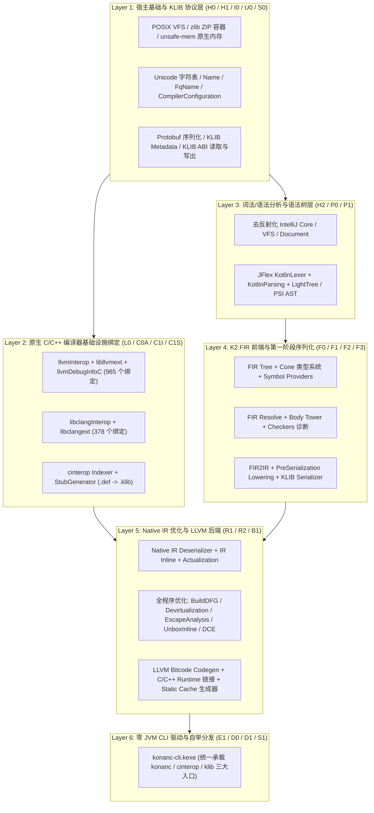

# 第 1 篇：为什么要脱掉 JVM？从 0 JVM 依赖看 Kotlin/Native 编译器的自举架构

## 1. 一个长期存在的悖论：编译出 Native 产物的编译器，自己却跑在 JVM 上

Kotlin/Native 的设计目标是让 Kotlin 代码摆脱虚拟机，直接通过 LLVM 编译为不依赖虚拟机的原生机器码（如 Linux ELF、macOS Mach-O、Windows PE）。然而在官方工具链中，**编译器自身（`konanc`、`cinterop`、`klib`）却是一个彻头彻尾的 JVM 应用程序**：

1. **启动与前端阶段**：`konanc` 通过 Shell 脚本拉起 JDK，加载数百 MB 的 `kotlin-native-compiler-embeddable.jar`，在 HotSpot JVM 上初始化模拟的 IntelliJ 核心环境（`KotlinCoreEnvironment`）、JFlex 词法分析器、PSI/LightTree 语法树与 K2 FIR 前端。
2. **中端与后端阶段**：KLIB 的 ZIP 打包读写依赖 `java.nio.file.FileSystems`；到了 LLVM Bitcode 生成或 `cinterop` 解析 C 头文件时，又必须通过 **JNI（Java Native Interface）** 跨过托管堆边界去调用 `libllvmext.so` 与 `libclangext.so`。
3. **并发构建的资源放大效应**：在现代多核机器上执行并行构建（如 `make -j16` 或多模块并发 `cinterop` / `.kt -> .klib`）时，每个编译子任务都会拉起一个独立的 JVM 进程。16 个并发进程意味着 **16 套独立的 JVM 堆 + 上百个后台 C1/C2 JIT 编译线程与 G1GC 线程同时抢占物理核心**。

这就引出了一个核心工程问题：
> **既然 Kotlin/Native 已经能够编译复杂的系统软件，能不能让 Kotlin/Native 编译器把“自己”编译成原生 ELF 可执行文件（`konanc-cli.kexe`），彻底脱掉 JVM 与 JNI？**

---

## 2. 设计原则：整文件复用上游算法 + 最小化平台宿主适配

从零手写一个兼容 Kotlin 2.4 语法的编译器既不现实，也无法保证与官方编译器的语义及 ABI 100% 一致。因此，我们在固定上游基线（`JetBrains/kotlin` @ `9180ce6a7a7d3627f88b424717583f28ddca052d`，版本号 `2.4.20-dev-7885`）上确立了严格的移植原则：

- **编译器核心算法 0 重写**：
  - K2 FIR 树、Cone 类型推导、重载决策、数据流分析（CFG/DFG）、诊断报告器（Checkers）、FIR2IR、KLIB 序列化协议（Protobuf + 二进制表）、Native IR Lowering、全程序优化（去虚化、逃逸分析、拆箱内联、死代码消除）以及 LLVM Bitcode 发射器，**全部直接使用上游源码**。
- **剥离非目标后端，聚焦 Native 闭环**：
  - 仅保留编译 Kotlin/Native 目标所需的 `3,430` 个生产源文件，剔除 JVM 字节码生成（`codegen`）、JS/Wasm 后端及 Gradle Daemon / JPS 构建器耦合。
- **用纯 Kotlin/Native 宿主层（Host Shims）替代 JDK 与 JNI**：
  - 凡是触及 `java.io.*`、`java.nio.*`、`java.util.zip.*`、`java.lang.reflect.*`、`java.util.ServiceLoader` 或 JNI `System.loadLibrary` 的边界，均通过最小化的 Kotlin/Native 宿主适配层（基于 `platform.posix`、`platform.zlib` 与 C Interop 静态绑定）原位替换。

---

## 3. 自底向上的 55-KLIB 编译器架构拓扑

为了将 `3,430` 个编译器生产源文件编译并链接为单一原生可执行文件 `konanc-cli.kexe`，我们将整个编译器拆解为自底向上的 **6 大架构层（共 55 个 KLIB 模块）**：

---

## 4. 彻底告别 JNI：从“跨语言桥接”到“同一地址空间直连”

在官方 JVM 版编译器中，`cinterop` 和后端代码生成之所以慢且耗内存，很大程度上源于 **JVM 托管堆与 C/C++ 原生堆之间的 JNI 鸿沟**：
- 每一次 AST/IR 节点生成 LLVM 指令，或 `cinterop` 遍历 Clang AST 游标（`CXCursor`），都需要在 JVM 与 Native 之间做 JNI 签名转换、句柄包装与跨堆内存拷贝。
- 在我们的 Native 宿主架构中，编译器自身就是运行在 `linux_x64` 上的原生代码，与 `libllvmext`（LLVM 21）和 `libclangext`（Clang 21）处于**同一个原生地址空间**。
- 正因如此，在 `cinterop` 真实头文件解析与 KLIB 生成测试中（见 [评测报告](../benchmarks/README.md)），自托管 Native 工具链单次耗时仅 **`0.124s`**，比官方 JVM 工具链（`1.527s`）快了整整 **`12.31 倍`**！

下一篇我们将深入代码细节，看看如何在没有 `java.lang.reflect`、没有 `java.nio`、也没有 IntelliJ 类加载器的情况下，让庞大的 IntelliJ PSI 与 K2 FIR 前端在 Kotlin/Native 上原汁原味地跑起来。
