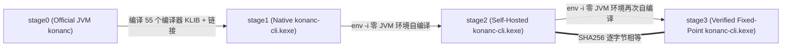

# 第 3 篇：55 个 KLIB 与三阶段自举：`stage0 -> stage1 -> stage2 == stage3` 逐字节不动点

在编译器工程中，衡量一个自托管编译器（Self-Hosted Compiler）是否真正成熟，最高标准只有一个——**三阶段自举不动点（Three-Stage Bootstrap Fixed Point）**。

---

## 1. 什么是三阶段自举（`stage0 -> stage1 -> stage2 -> stage3`）？

1. **`stage0 -> stage1`（交叉构建引导）**：
   - 使用官方基线的 JVM 版编译器（`stage0`），将适配后的 `3,430` 个编译器源文件按拓扑序编译为 **55 个 KLIB 模块**，并链接生成第一个原生编译器可执行文件 `stage1/konanc-cli.kexe`。
   - 此时 `stage1` 已经是一个无需 JVM 的 Linux ELF 二进制文件，但它的机器码是由 `stage0`（JVM 编译器）生成的。
2. **`stage1 -> stage2`（首次无 JVM 自编译）**：
   - 在 `env -i PATH=/nonexistent` 隔离环境下（彻底切断 `java`、系统 PATH 与外部环境变量），用 **`stage1/konanc-cli.kexe` 编译编译器自身的源码**，并结合纯 Native 重建的 `stdlib`、平台库（`posix`、`zlib` 等）与 C++ Runtime，生成 `stage2/konanc-cli.kexe`。
3. **`stage2 -> stage3`（不动点验证）**：
   - 同样在 `env -i PATH=/nonexistent` 下，用 **`stage2/konanc-cli.kexe` 再次编译编译器自身**，生成 `stage3/konanc-cli.kexe`。
   - 如果 `stage2/konanc-cli.kexe` 与 `stage3/konanc-cli.kexe` **逐字节完全相同（Bit-for-Bit Identical）**，则证明自托管编译器在自身庞大的代码闭包上没有任何代码生成漂移、内存越界或非确定性行为。

---

## 2. 攻克全量链接的内存墙：Static Cache + 三步式 Bitcode 链接配方

编译器自身包含 `3,430` 个源文件、导出 `474,762` 个符号。如果把全部 55 个 KLIB 直接丢给单次 `konanc -produce executable` 从头做 IR 反序列化和 LLVM 代码生成，峰值内存很容易突破数 GB。

为了让整个自举过程能够在资源受限的设备（甚至 **2 GiB 内存上限、0 Swap** 的受限容器）中稳定完成，我们设计了两个关键工程机制：

1. **全链路预构建静态缓存（`static_cache` / `linux_x64-gSTATIC`）**：
   - 提前为下游依赖的 KLIB（包括 5 片段 `stdlib`、`llvm`、`c1s-stub-generator`、`r1s-konan-resolve`、`b1k-backend-native`、`f3e-fir-entrypoint`、`f3e-cli-native-klib`、`e1k-kotlinp-klib`、`e1k-klib-tool`、`e1k-cli-utilities` 等）生成预编译静态库缓存（`.a` + 预计算内联/缓存元数据）。
   - 在链接 `stage2` 和 `stage3` 时，编译器只需对顶层入口模块做增量 LLVM Bitcode 发射（`-Xtemporary-files-dir=...`），其余 54 个模块直接复用静态缓存归档。
2. **三步式低内存代码生成与链接**：
   - **第 1 步（Bitcode 发射）**：`konanc-cli.kexe` 消费 KLIB 与全部 `-Xcache-directory`，输出临时 `program.kt.bc`。
   - **第 2 步（原生目标文件生成）**：调用捆绑的 `clang++ -cc1 -emit-obj` 将 `program.kt.bc` 编译为 `stage.o`。
   - **第 3 步（确定性静态/动态链接）**：将 `stage.o`、55 个模块的 `lib*-cache.a`、`libllvmext.a`、`libclangext.a`、LLVM 21 静态库与 `lld` 链接为最终的 `konanc-cli.kexe`。

实测这套配方将整个 `S1` 自举与全量回归测试的**内存峰值控制在仅 `1.3 GiB`（`0 B` Swap）**，总耗时仅 **4 分 52.9 秒**！

---

## 3. 实测验证结果：`185,383,000` 字节逐字节完全一致

在 `xiaoxin-ubuntu`（`linux_x64`）上实测的三阶段产物指纹如下（详见 [`bootstrap/manifests/fixed-point-report.md`](../bootstrap/manifests/fixed-point-report.md)）：

| 阶段 | 二进制大小 (Bytes) | 导出定义符号数 (`nm -D --defined-only`) | KLIB ABI SHA256 (`klib dump-abi -signature-version 2`) | 可执行文件 SHA256 (`konanc-cli.kexe`) |
| :--- | :---: | :---: | :--- | :--- |
| **`stage1`** | `166,199,088` | `474,762` | `5366cdb5bc967940024f28345e57a8787f9398bcbe8de9ff9d98278296cd8860` | `246c38344d6d098c48f6af1cb716f362bd078ce57d3731f589f5694e650eb99d` |
| **`stage2`** | `185,383,000` | `474,762` | `5366cdb5bc967940024f28345e57a8787f9398bcbe8de9ff9d98278296cd8860` | **`cdf4849a9f9a2a4892348a8b27face322c89f78dbfc8f99ccbbc1886701d025e`** |
| **`stage3`** | `185,383,000` | `474,762` | `5366cdb5bc967940024f28345e57a8787f9398bcbe8de9ff9d98278296cd8860` | **`cdf4849a9f9a2a4892348a8b27face322c89f78dbfc8f99ccbbc1886701d025e`** |

- **`stage1 == stage2 == stage3` KLIB ABI**：三代编译器产出的 KLIB ABI 签名 **100% 相同**。
- **`stage2 == stage3` 二进制不动点**：`185,383,000` 字节的 ELF 可执行文件 **SHA256 逐位相等**。
- **全量回归与差分测试 `0` 差异**：
  - `E1` 8-Section 测试集（覆盖 `konanc`、`cinterop`、`klib`、多模块依赖、`-friend-modules`、`static_cache`、语法/类型错误诊断）：`stage2` 与 `stage3` 输出同 JVM Oracle **`0` diff**。
  - `D1` 7-Section 标准库与运行时语料测试集（覆盖集合/序列、协程状态机、反射/KClass、原子操作、C 桥接回调、POSIX I/O、`zlib` 压缩）：`stage2` 与 `stage3` 输出同 JVM Oracle **`0` diff**。

达成自举不动点之后，更令人兴奋的问题来了：**这个彻底摆脱了 JVM 的原生编译器，以及它开启全程序优化（`konanc -opt`）后编译出的原生程序，在单核与多核下的真实性能究竟如何？** 请看第 4 篇实测报告。
